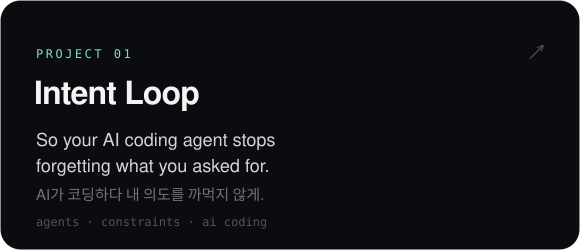
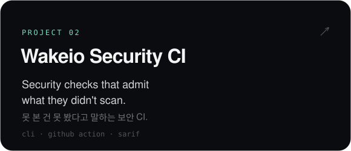

  

  <a href="https://www.linkedin.com/in/%EC%9D%B8%ED%98%B8-%EC%B5%9C-784356437/">LinkedIn</a>
  &nbsp;·&nbsp;
  <a href="https://inho-self-introduction.vercel.app/">Portfolio</a>
  &nbsp;·&nbsp;
  <a href="mailto:dusen3846@gmail.com">Email</a>

 

  
  

 

  

No pressure, no diamonds.

